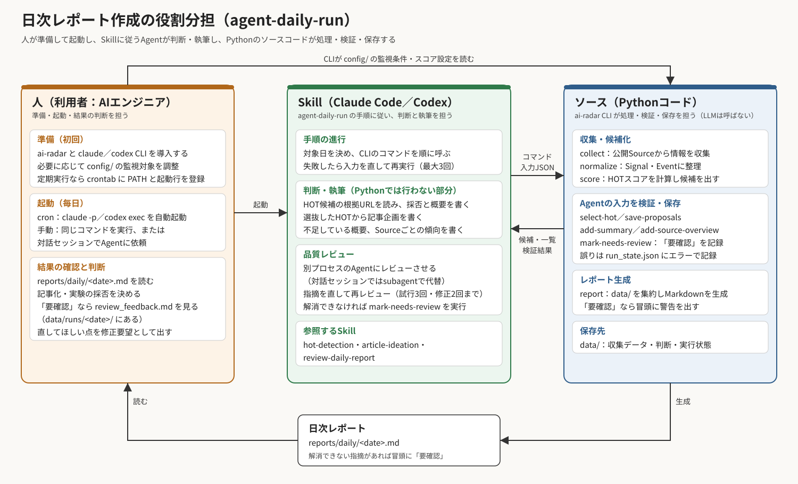

# AI Research Radar ドキュメント

AI関連の研究・ツール・発表を収集し、根拠付きの日次レポートと記事企画をAIエンジニアの判断につなげる。文書は、必要な結果を合意してから実現方式と確認方法へ進める順に配置する。

## 入口と読む順

| 順序 | 入口 | 答える問い |
| --- | --- | --- |
| 1 | [仕様・設計（spec）](spec/README.md) | 何を満たし、どう実現・検証するか |
| 2 | [開発・運用支援（support）](support/README.md) | どう動かし、作業を進めるか |

まずspecで要求・要件から設計と検証方法を確認し、実行や作業計画にはsupportを参照する。配下の数字はそれぞれのまとまりの読む順であり、開発は要件・設計・検証の間を往復してよい。参考調査は開発の必須工程ではない。

## 日次レポート作成の役割分担

Agent経路ではClaude CodeまたはCodexが共通Skillを読み、Python CLIを実行しながら根拠確認・選抜・文章・企画を作る。一括 `daily` はPythonによる決定論的な経路である。詳しくは [実行経路と責任](spec/02-architecture/workflows.md) を参照。

## 文書の正本と状態

- 必要な結果・受入条件はspec/01-requirements、実現方式はspec/02-architecture・03-detailed-design、確認方法はspec/04-verificationを正本とする。
- 操作手順はsupport/01-operations、未達・未検証の状態はsupport/02-planningを正本とする。
- spec/05-decisionsの変更設計は目標仕様を含む。現行動作に適用されたとみなす前に、support/02-planningの適用状況を確認する。
- 要件IDを使って相互参照する。コードが存在すること、CLIへ接続されていること、受入済みであることは分けて記録する。
- Claude CodeとCodexは同じ文書と `skills/` を参照する。Agentごとの設計書を複製しない。

## 再編の範囲

2026-10-10、旧 `docs/specs/01〜09` をテーマ別に分割した。[移行対応表](support/02-planning/document-migration.md)から旧章の移動先を確認できる。既存の要求を要件IDで整理したが、品質改善の接続や機能追加は実装していない。今回の再編は文書体系の承認に基づき、未決定の数値や新たな機能要件を確定するものではない。

2026-10-12、仕様・設計をspec、運用・計画・参考資料をsupportへまとめた。既存テスト資料の再分類や実行手順の追加は別途指示を受けて行い、今回は既存の配置を各移動先の中で維持する。
